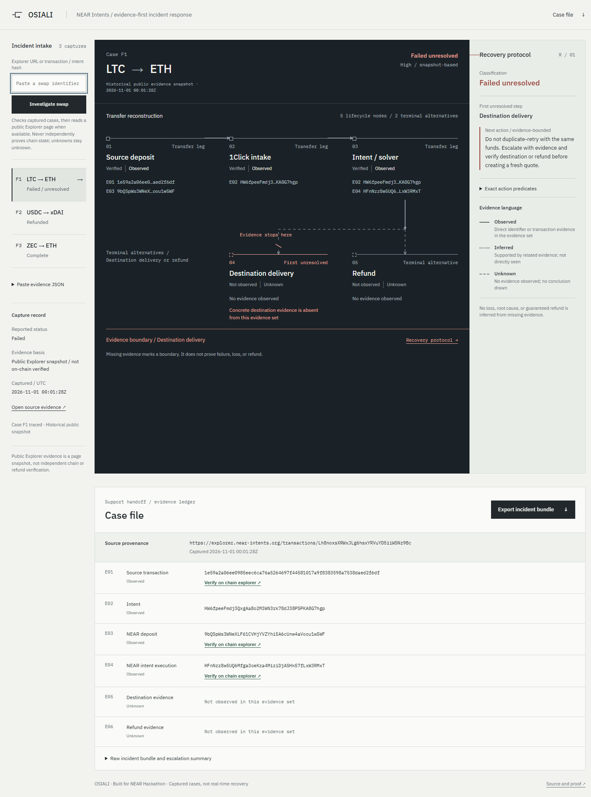

# OSIALI

Investigate a stalled NEAR Intents swap and prepare a support-ready case.

OSIALI reconstructs the transfer route, identifies the first unresolved step, separates available evidence from unknowns, and recommends what to check next. Export the investigation with identifiers, evidence links and an escalation summary.

[Open OSIALI](https://osiali.vercel.app) · [Evidence and limitations](docs/EVIDENCE.md) · [How it works](docs/ARCHITECTURE.md)



## Investigate a swap

1. Paste a public NEAR Intents Explorer transaction URL or record ID and select **Investigate swap**.
2. Follow the route to the first unresolved step and read the recommended action.
3. Export the incident bundle to share with support.

Try the captured [unresolved](https://osiali.vercel.app/?demo=F1), [refunded](https://osiali.vercel.app/?demo=F2) and [completed](https://osiali.vercel.app/?demo=F3) cases. They are historical public snapshots, not live transfer monitoring.

Deposit addresses now use the official read-only 1Click status lookup, with memo support when supplied. Explorer records use fresh public-page retrieval before any clearly labelled historical fallback. If lookup cannot resolve your swap, use the guided case form—no JSON required. Advanced JSON remains available. Supplied evidence stays provisional and does not establish verification. [Input format](docs/INPUTS.md).

## Run locally

Use Node.js 22 or later. There are no third-party runtime dependencies.

```sh
git clone https://github.com/ShalyX/osiali.git
cd osiali
npm test
npm run red-team
npm start
```

Open http://127.0.0.1:4173. `npm run build` creates the static bundle; Vercel serves the separate read-only API route.

## NEAR integration and boundaries

NEAR Intents is the investigation surface: source deposit → 1Click intake → intent/solver → destination delivery or refund. Public lookup reads source-attributed Explorer HTML. It does not independently establish chain finality, track refunds in real time, custody funds or execute recovery. Missing evidence does not prove loss or protocol fault.

Manual reports require checking original sources before any financial action. Never send private keys or credentials in evidence JSON.

## Validation

Run `npm test`, `npm run red-team` and `npm run evidence:benchmark`. The repeatability benchmark classifies three captured cases 10,000 times; it is not an accuracy study or user-impact measurement. [Current verification](docs/EVIDENCE.md).

Built for NEAR HACKATHON 2026. Tracks: Unstoppable DeFi and Open Innovation. [Submission status](docs/SUBMISSION.md).

## License

[MIT](LICENSE). Bundled IBM Plex fonts retain their own licenses in `public/fonts/`.
